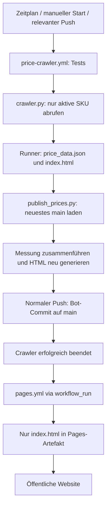

# Projektübergabe: FRITZ!Box-Preistracking

**Dokumentationsstand: 14. November 2026 · Zeitzone: Europe/Berlin**

Diese Datei dient als anbieterunabhängige Wissensübergabe für Menschen und KI-Coding-Assistenten, beispielsweise Codex oder Google Antigravity. Sie verbindet überprüften Quellcode, Git-Historie, aktuelle GitHub-Betriebsdaten und den tatsächlich zugänglichen Gesprächsverlauf. Sie ist keine neue Produktspezifikation und keine Aufforderung, sämtliche erwähnten Wartungsmöglichkeiten sofort umzusetzen.

## Schnellüberblick und unverzichtbare Regeln

- **Aktiv getrackt wird ausschließlich die FRITZ!Box 5630, SKU `20003150`.**
- **Die FRITZ!Box 5530 Fiber, SKU `20002960`, ist ein abgeschlossenes Archiv. Ihre 77 bisherigen Tagesmessungen müssen erhalten bleiben; ihre Produktseite wird nicht mehr abgefragt.**
- Das Projekt besteht aus zwei Python-Skripten, einer versionierten JSON-Datei und einer daraus generierten statischen HTML-Seite. Es gibt keinen laufenden Webserver als Anwendungs-Backend und keine Datenbank.
- GitHub Actions erledigt den täglichen Abruf und speichert Ergebnisse als Bot-Commit. Ein zweiter Workflow veröffentlicht anschließend die HTML-Seite mit GitHub Pages.
- `price_data.json` ist die dauerhafte Datenbasis. `index.html` ist generiert. Änderungen an der Darstellung gehören in `crawler.py`, nicht ausschließlich in `index.html`.
- Ein Push-Konflikt darf weder durch Force-Push noch durch das Überschreiben der entfernten Historie gelöst werden. `publish_prices.py` enthält dafür bereits eine getestete Zusammenführung mit begrenzten Wiederholungen.
- **Der lokale Datenstand wurde am 14.11.2026 mit dem Online-Datenstand synchronisiert.** Zukünftig weiterhin darauf achten, keine lokalen Stände blind über neuere Online-Messungen zu schreiben.
- Für die Erstellung dieser Datei waren ausdrücklich nur Dokumentationsänderungen erlaubt. Es wurden keine bestehenden Projektdateien geändert, keine Abhängigkeiten installiert, keine Projekt-Commits erzeugt und keine Deployments oder erneuten Läufe ausgelöst.

## Quellen, Belegstatus und Gültigkeit

Die folgenden Kennzeichnungen trennen Wissen von Schlussfolgerungen:

| Kennzeichnung | Bedeutung |
| --- | --- |
| **Code** | Direkt aus den genannten lokalen Dateien überprüft. |
| **Git** | Durch lokale Historie oder lesend abgefragte GitHub-Commits und Dateien belegt. |
| **Betrieb, 14.11.2026** | Bei dieser Übergabe über die GitHub-Verbindung lesend überprüfter Zustand. Kann später veralten. |
| **Gespräch** | Im hier zugänglichen Gesprächsverlauf ausdrücklich besprochen oder beobachtet. |
| **Codebefund / mögliche Verbesserung** | Aus der Implementierung ableitbare Grenze; kein Beleg, dass dadurch bereits ein Produktionsfehler entstanden ist. |
| **Nicht geprüft / unbekannt** | Keine ausreichende zugängliche Evidenz. Nicht als bestätigte Tatsache behandeln. |

Zugänglich ist der in dieser Unterhaltung sichtbare Projektverlauf von der ersten Einrichtung über Fehlerbehebungen bis zur Umstellung auf die 5630 und diesem Übergabeauftrag. **Es wird kein Zugriff auf sämtliche früheren Chats, andere Kontounterhaltungen oder den Verlauf eines anderen Assistenten behauptet.** Das ursprünglich als Vorbild erwähnte `flugcrawler`-Projekt ist keine Laufzeitabhängigkeit und wurde für diese Übergabe nicht erneut untersucht.

### Verifizierter Versions- und Betriebsstand

| Bereich | Stand bei Erstellung |
| --- | --- |
| Öffentliches Repository | [Moritz2011/router_preis](https://github.com/Moritz2011/router_preis) |
| Website | [moritz2011.github.io/router_preis](https://moritz2011.github.io/router_preis/) |
| Branch / Remote | Lokal `main`; `origin` verweist per SSH auf dieses Repository. |
| Lokaler HEAD | `2e1258956aff8dca50010479e4f87ebe410e84b9` – `Preisupdate 2026-11-14` (synchronisiert per Fast-Forward-Merge) |
| Online-HEAD, lesend geprüft | `2e1258956aff8dca50010479e4f87ebe410e84b9` – `Preisupdate 2026-11-14` |
| Unterschied online zu lokal | Synchron; die 9 Bot-Commits vom 06.–14.11. wurden per Fast-Forward übernommen. |
| Lokale aktive Historie | 9 Tagesmessungen vom 06.–14.11.2026. Letzte Messung: 14.11.2026, 15:12:03 Uhr MEZ, 239,99 EUR, verfügbar. |
| Online aktive Historie | 9 Tagesmessungen vom 06.–14.11.2026. Letzte Messung: 14.11.2026, 15:12:03 Uhr MEZ, 239,99 EUR, verfügbar. |
| Archiv, lokal und online | 5530 Fiber: 77 Messungen vom 21.08.–05.11.2026; Produktdaten und sämtliche Messwerte bei der Übergabe auf Gleichheit geprüft. Tiefstpreis 169,99 EUR, Höchst-/letzter Preis 199,99 EUR; letzter Lieferstatus nicht verfügbar. |
| Arbeitsverzeichnis vor Übergabe | Sauber; keine bestehenden uncommitteten Änderungen. `PROJECT_HANDOVER.md` existierte noch nicht. |
| Offene GitHub-Issues | Die lesend abgefragte Liste offener Issues war leer. |

Die Preise in dieser Tabelle sind **gespeicherte Messwerte mit Datum**, keine während der Dokumentation neu abgefragten Shop-Angebote. Ein aktueller Shop-Abruf wurde bewusst nicht durchgeführt.

Belege zum zuletzt geprüften Betrieb:

- [Crawler-Lauf vom 14.11.2026](https://github.com/Moritz2011/router_preis/actions/runs/43603600575): erfolgreich, einschließlich Tests, Abruf und Speichern.
- [Pages-Lauf vom 14.11.2026](https://github.com/Moritz2011/router_preis/actions/runs/43603625408): erfolgreich.
- [Vergleich lokaler Ausgangsstand / geprüfter Online-Stand](https://github.com/Moritz2011/router_preis/compare/6351c5f...2e1258956aff8dca50010479e4f87ebe410e84b9): nur generierte Daten und HTML geändert.

## Inhalt

- [A. Projektübersicht und Zielsetzung](#a-projektübersicht-und-zielsetzung)
- [B. Technische Architektur](#b-technische-architektur)
- [C. Bereits implementierte Funktionen](#c-bereits-implementierte-funktionen)
- [D. Entscheidungen und Hintergründe](#d-entscheidungen-und-hintergründe)
- [E. Anforderungen und Entwicklungsrichtlinien](#e-anforderungen-und-entwicklungsrichtlinien)
- [F. Bekannte Fehler, Einschränkungen und technische Schulden](#f-bekannte-fehler-einschränkungen-und-technische-schulden)
- [G. Offene Aufgaben und Prioritäten](#g-offene-aufgaben-und-prioritäten)
- [H. Letzter Entwicklungsstand](#h-letzter-entwicklungsstand)
- [I. Installation, Ausführung und Deployment](#i-installation-ausführung-und-deployment)
- [J. Tests und Qualitätssicherung](#j-tests-und-qualitätssicherung)
- [K. Konkrete Hinweise für den nächsten KI-Assistenten](#k-konkrete-hinweise-für-den-nächsten-ki-assistenten)

## A. Projektübersicht und Zielsetzung

### Zweck und Zielgruppe

Das Projekt beobachtet den Preis eines bestimmten Routers im offiziellen FRITZ!-Onlineshop. Es löst die wiederkehrende manuelle Kontrolle einer Produktseite und hält einen eigenen Tagespreisverlauf fest. Der Nutzer möchte die Ergebnisse jederzeit unter einer festen Internetadresse ansehen können, ohne den eigenen Rechner für die Automatisierung eingeschaltet lassen zu müssen. Zielgruppe sind primär der Projektinhaber und Besucher der öffentlichen Preisübersicht. **Gespräch; Code: `crawler.py`, beide Workflows.**

Ursprünglich wurde am 21.08.2026 die FRITZ!Box 5530 Fiber beobachtet. Am 06.11.2026 wurde auf ausdrücklichen Wunsch des Nutzers auf die FRITZ!Box 5630 umgestellt, da das alte Modell nach dessen Angabe nicht mehr angeboten wird. Der alte Verlauf sollte sichtbar bleiben, aber nicht fortgeschrieben werden. Diese Unterscheidung ist fachlich wesentlich: Ein Modellwechsel setzt den aktiven Preisverlauf neu auf, statt unterschiedliche Geräte in einer Zeitreihe zu vermischen.

### Vereinbarter Funktionsumfang

1. Täglich Preis und Lieferbarkeit der aktiven SKU aus genau diesem Shop abrufen.
2. Einen Messwert pro Kalendertag in deutscher Zeitzone speichern.
3. Den Verlauf dauerhaft im GitHub-Repository erhalten.
4. Aktuellen beziehungsweise zuletzt gemessenen Preis, Trend, Tiefst-/Höchstpreis und Diagramm im Browser anzeigen.
5. Ausgemusterte Modelle mit eigenem Verlauf als Archiv erhalten.
6. Abruf, Bot-Commit und Veröffentlichung möglichst ohne manuelle tägliche Eingriffe betreiben.

Das ist kein Vergleichsportal über mehrere Händler, kein Kaufautomat und keine Echtzeit-Lagerauskunft. Benachrichtigungen, Preisalarme, Benutzerkonten, eine Datenbank, ein Anbieterwechsel beim Hosting oder mehrere gleichzeitig aktive Router wurden **nicht als neue Anforderungen vereinbart**.

### Aktueller Reifegrad und langfristige Ziele

Der vereinbarte Funktionsumfang ist implementiert und produktiv. Die jüngsten überprüften Tagesläufe sind erfolgreich. Es gibt keine im Code markierte angefangene Funktion und keinen bestätigten offenen Funktionsauftrag nach dem Modellwechsel. Das weiter erkennbare Ziel ist ein kleiner, zuverlässig wartbarer persönlicher Preisbeobachter mit dauerhafter Historie. Ein darüber hinausgehender langfristiger Produktplan ist nicht dokumentiert.

## B. Technische Architektur

### B.1 Technologien und Zuständigkeiten

| Bereich | Umsetzung |
| --- | --- |
| Abruf und Verarbeitung | Python; in GitHub Actions Python 3.12. |
| Python-Abhängigkeit | `requests==2.32.5` in `requirements.txt`; weitere direkte Pakete sind nicht eingetragen. Transitive Abhängigkeiten sind nicht vollständig gelockt. |
| Standardbibliothek | Unter anderem `json`, `datetime`, `zoneinfo`, `html.parser`, `html`, `subprocess`, `tempfile`, `unittest`. |
| Frontend | Statisches HTML mit eingebettetem CSS und JavaScript; das Template liegt in `crawler.py`. |
| Diagramme | Chart.js 4.4.7, geladen von jsDelivr. Kein npm-Projekt, kein Bundler, kein Frontend-Build. |
| Datenhaltung | Versionierte Datei `price_data.json`; keine SQL-/NoSQL-Datenbank. |
| Automatisierung | GitHub Actions, zwei getrennte Workflows. |
| Hosting | GitHub Pages im Modus für eigene Actions-Workflows. Keine Sites-/Supabase-Abhängigkeit. |
| Benutzerverwaltung | Nicht vorhanden; die Website ist öffentlich und hat keine Anmelde- oder Bearbeitungsoberfläche. |

Die Batch-Verarbeitung ist das funktionale „Backend“. Ein Python-Prozess läuft nur während des lokalen Aufrufs oder CI-Jobs. Der Besucher erhält bereits fertige HTML-Inhalte. Der Browser fragt weder den Shop noch `price_data.json` selbst ab; Diagrammdaten werden beim Generieren in die HTML-Datei eingebettet.

### B.2 Verzeichnisstruktur

```text
.
├── crawler.py                    # Shop-Abruf, Validierung, Migration, HTML-Generator
├── publish_prices.py             # Zusammenführen und konfliktfestes Veröffentlichen
├── price_data.json               # Dauerhafte aktive Historie und Archive; versioniert
├── index.html                    # Generierte Website; ebenfalls versioniert
├── requirements.txt              # requests-Pin
├── README.md                     # Kurzanleitung für Betrieb und Datenformat
├── PROJECT_HANDOVER.md           # Diese ausführliche Übergabe
├── .gitignore
├── .github/
│   └── workflows/
│       ├── price-crawler.yml     # Tests → Abruf → Bot-Commit
│       └── pages.yml             # HTML-Artefakt → GitHub Pages
└── tests/
    ├── test_crawler.py            # 13 Parser-, Daten-, Archiv- und Rate-Limit-Tests
    └── test_publish_prices.py     # 7 Tests mit temporären echten Git-Repositories
```

`.gitignore` ignoriert `__pycache__/`, `*.py[cod]`, `.DS_Store`, `.venv/`, `.idea/` und `.vscode/`. Es gibt keine projektbezogene `AGENTS.md`, keine Paket-/Build-Konfiguration wie `pyproject.toml` oder `package.json`, keine Containerdefinition und keine eingecheckte `.env`-Konfiguration. `_site/` wird nur im Pages-Job erzeugt; es ist kein Quellverzeichnis. Build-/Cache- und Git-Interna sind keine zusätzlichen fachlichen Projektkomponenten.

### B.3 Daten- und Veröffentlichungsfluss



Die Dateien aus dem ersten lokalen Generierungsschritt werden nicht blind gepusht. Der Publisher lädt vor dem Commit erneut den entfernten Stand und erzeugt das HTML aus der zusammengeführten Historie. So gehen zwischenzeitliche Tagesmesswerte oder andere Repository-Änderungen nicht durch einen alten Checkout verloren.

### B.4 Shop-Schnittstellen

**Aktive Quelle:**

- Produktseite: `https://fritz.com/products/fritz-box-5630-20003150`
- Primärer JSON-Endpunkt: `https://fritz.com/products/fritz-box-5630-20003150.js`
- Erwartete SKU: `20003150`; Währung des Trackings: `EUR`.

Dies ist ein öffentlich abrufbarer Shopify-Produktendpunkt ohne Shop-Login oder API-Schlüssel. Es ist keine eigene API und kein vom Projekt garantiert stabiler Vertrag. Seitenstruktur und Endpunkt können sich beim Anbieter ändern.

`parse_product()` filtert die Antwort anhand der SKU innerhalb von `variants`. Es bevorzugt verfügbare passende Varianten; sind keine verfügbar, werden die passenden nicht verfügbaren Varianten weiterhin zur Preisbestimmung verwendet. Shopify-Preise in Cent werden durch 100 geteilt und auf zwei Nachkommastellen gerundet. `compare_at_price` ist optional. Bei mehreren passenden Varianten werden Preis und Vergleichspreis jeweils aus den betreffenden Zahlenlisten minimiert. Das ist keine allgemeine Variantenwahl-Oberfläche.

Scheitert die JSON-Quelle durch HTTP-/JSON-/Produktdatenfehler, wird einmal die kanonische HTML-Produktseite versucht. `JsonLdParser` liest ausschließlich `<script type="application/ld+json">`. `walk_json()` durchsucht verschachtelte Objekte/Listen nach einem `Product`; `parse_product_html()` sucht darin direkte `offers` für die erwartete SKU. Die dortigen Preise sind bereits Euro-Beträge. Als verfügbar wird ausschließlich ein Schema.org-Status mit Endung `InStock` erkannt. Der HTML-Fallback liefert keinen Vergleichspreis und kontrolliert die Währung, wobei ein fehlendes Währungsfeld als EUR behandelt wird.

**Rate-Limit-Ausnahme:** HTTP 429 löst keinen sofortigen HTML-Fallback aus. `get_shop_response()` berücksichtigt `Retry-After` als Sekundenwert oder HTTP-Datum. Es gibt höchstens einen erneuten Versuch am selben Endpunkt, bei einer erlaubten Wartezeit bis 60 Sekunden. Eine längere Wartezeit oder ein zweites 429 erzeugt `ShopRateLimitError`. Ohne verwertbaren Header werden 60 Sekunden angenommen. Damit wird die vom Shop angeforderte Pause nicht durch andere Requests unterlaufen.

Die Anfrage verwendet ein festes `HEADERS`-Dictionary mit Accept, deutscher Accept-Language und einer älteren Chrome-User-Agent-Zeichenfolge. Der Timeout ist `(10, 30)` für Verbindung beziehungsweise Lesen; das ist keine globale Gesamtlaufzeit aller Requests. Keine Browser-Automatisierung und kein CAPTCHA-Umgehen sind Teil des Crawlers.

Die ehemalige 5530-URL bleibt als Quelleninformation im Archiv gespeichert. Das ist **keine** Aufforderung zu weiteren Netzwerkabfragen dieses Modells.

### B.5 Datenmodell und Migration

Die aktive Datenstruktur hat `schema_version: 2`:

```json
{
  "schema_version": 2,
  "product": {
    "name": "FRITZ!Box 5630",
    "sku": "20003150",
    "url": "https://fritz.com/products/fritz-box-5630-20003150",
    "currency": "EUR"
  },
  "observations": [
    {
      "date": "2026-11-06",
      "timestamp": "2026-11-06T15:18:03+01:00",
      "price": 254.99,
      "compare_at_price": null,
      "available": true
    }
  ],
  "archives": [
    {
      "product": {
        "name": "FRITZ!Box 5530 Fiber",
        "sku": "20002960",
        "url": "https://fritz.com/products/fritz-box-5530-fiber-20002960",
        "currency": "EUR"
      },
      "observations": [],
      "archive_reason": "Dieses Modell wird nicht mehr angeboten. Das Tracking ist beendet."
    }
  ]
}
```

**Das ist nur ein gekürztes Schema-Beispiel. Die leere Liste der Archivmessungen im Beispiel darf niemals die 77 echten Archiv-Messungen ersetzen.** Tatsächlich enthält `archives[0].observations` dieselben Felder je Messung wie die aktive Liste.

Wichtige Regeln:

- `date` ist der ISO-Kalendertag der übergebenen Berliner Zeit; `timestamp` ist ein ISO-Zeitstempel mit UTC-Offset und Sekundengenauigkeit.
- `run()` erfasst die Zeit **vor** dem Abruf. Bei einer Wartezeit kann sie vom tatsächlichen Ende des Requests abweichen.
- `update_history()` ersetzt den aktiven Messwert desselben Tages und sortiert aktive Messungen nach Datum. Es speichert keine vollständige Intraday-Historie.
- `price` und `compare_at_price` sind Zahlen in Euro, keine deutschen Preisstrings. Der Vergleichspreis darf `null` sein; `available` ist ein boolescher Shop-Status.
- Ein vorhandener Preis wird auch bei `available: false` erfasst. „Nicht verfügbar“ bedeutet hier nicht „Crawler fehlgeschlagen“.
- `prepare_history()` migriert das alte Einzelmodellformat beim Laden zunächst nur im Speicher. Bei SKU `20002960` wird der bisherige Datensatz mit Produktinformationen und Messwerten ins Archiv übernommen und die aktive 5630-Liste leer angelegt.
- Der aktive Abruf erfolgt in `run()` vor dem Speichern. Ein fehlgeschlagener neuer Abruf schreibt daher nicht bereits eine leere aktive Historie über die alte Datei.
- Wiederholtes Vorbereiten des aktuellen Formats dupliziert das Archiv nicht. Unerwartete aktive SKUs und ein bei der Legacy-Migration bereits doppelt vorhandenes 5530-Archiv werden abgelehnt.
- Die Archivdarstellung kann Listen mehrerer abgeschlossener Modelle rendern. Die automatische Migration ist jedoch konkret auf den Übergang 5530 → 5630 ausgelegt; sie ist kein universelles Produktregister.
- Archive werden durch die normale Aktualisierung nicht fortgeschrieben. Sie sind fachlich eingefroren, nicht durch Dateirechte technisch unveränderlich. Manuelle falsche Änderungen bleiben möglich und müssen über Review und Tests verhindert werden.

### B.6 Konfiguration, Umgebungsvariablen und Authentifizierung

| Einstellung | Ort und Bedeutung |
| --- | --- |
| `PRODUCT_NAME`, `PRODUCT_URL`, `PRODUCT_JSON_URL` | `crawler.py`; aktives Produkt und abgeleiteter JSON-Endpunkt. |
| `EXPECTED_SKU`, `RETIRED_SKU` | `crawler.py`; Identität des aktiven Produkts und bekannte Legacy-Migration. |
| `CURRENCY`, `TIMEZONE` | `crawler.py`; EUR und `ZoneInfo("Europe/Berlin")`. |
| `ROOT`, `DATA_FILE`, `DASHBOARD_FILE` | `crawler.py`; Pfade relativ zur Skriptdatei, nicht relativ zum Aufrufverzeichnis. |
| `HEADERS` | `crawler.py`; HTTP-Anfrageeinstellungen, ohne geheime Werte. |
| `max_attempts` | Parameter von `publish_prices.publish()`, Standard 3. |
| `PYTHONIOENCODING`, `PYTHONUNBUFFERED` | Crawler-Workflow; UTF-8 beziehungsweise direktes Log-Ausgeben. |
| `GITHUB_TOKEN` | Von GitHub bereitgestellte Job-Authentifizierung, indirekt über Checkout und Actions genutzt. Kein Token-Wert im Projekt. |
| `github.run_attempt` | GitHub-Kontext für eindeutige Artefaktnamen pro Wiederholung. |

Die Anwendung selbst liest keine `.env` und bietet keine CLI-Flags oder benutzerspezifische Konfigurationsoberfläche. Ein neuer KI-Assistent darf solche Möglichkeiten nicht als bereits vorhanden beschreiben.

Der Crawler braucht keine Shop-Zugangsdaten. Git-Pushes benötigen Repository-Schreibrechte; Pages benötigt Pages-/OIDC-Berechtigungen. Die historische Einrichtung erfolgte lokal über einen vorhandenen SSH-Zugang und eine vom Nutzer bestätigte Anmeldung der offiziellen GitHub CLI für Repository-Einstellungen. Diese gerätegebundene Einrichtung ist **keine mitgelieferte Projektabhängigkeit** und kein automatisch an einen anderen Assistenten übertragener Zugriff. Keine Schlüssel, Tokens, Login-Codes oder Inhalte lokaler Anmeldespeicher gehören in diese Datei.

## C. Bereits implementierte Funktionen

| Funktion / Status | Umsetzung und Code | Abhängigkeiten und Einschränkungen |
| --- | --- | --- |
| Aktiver Preisabruf – vollständig | `crawler.py`: `fetch_product()`, `parse_product()` | Nur die konfigurierte 5630-SKU; öffentliche Shop-Schnittstelle. |
| HTML-Fallback – vollständig im vereinbarten Umfang | `JsonLdParser`, `walk_json()`, `parse_product_html()` | Benötigt passende JSON-LD-Produkt-/Offer-Daten; kein generischer sichtbarer Text-/CSS-Scraper. |
| Rate-Limit-Behandlung – vollständig im implementierten Umfang | `get_shop_response()`, `ShopRateLimitError` | Ein Retry bis 60 Sekunden; keine unbegrenzten Versuche und kein sofortiger Fallback bei 429. |
| Tageshistorie – vollständig | `new_history()`, `load_history()`, `update_history()`, `save_history()` | Ein Wert pro Tag; lokale JSON-Datei wird direkt geschrieben. |
| Modellwechsel mit Archiv – vollständig | `prepare_history()` und `render_archive()` | 5530-Daten bleiben erhalten; keine Abfragen archivierter Modelle. |
| Dashboard – vollständig | `generate_dashboard()` in `crawler.py`, Ausgabe `index.html` | Aktueller Preis, Vergleichspreis falls höher, Trend zur vorherigen Messung, Min/Max, Lieferstatus und Chart. |
| Historischer Modellbereich – vollständig | `render_archive()` | Letzter Preis-/Lieferstatus, eigener Min/Max-Verlauf, Diagramm, alle Tagesmessungen in aufklappbarer Tabelle, Erfassungszeitraum und ehemalige Produktquelle. |
| Deutsches Format – vollständig | `format_eur()`, ISO-Daten, Berliner Zeitzone | Euro-Ausgabe mit Komma, Datum/Zeit deutsch; Datenhaltung bleibt numerisch/ISO. |
| Konfliktfestes Speichern – vollständig für abgedeckte Szenarien | `publish_prices.py`: `git()`, `fetch_main()`, `merge_observation()`, `publish()` | Normale Pushes, bis zu 3 Versuche; keine allgemeine Git-Konfliktauflösung für beliebige Dateien. |
| Täglicher autonomer Betrieb – vollständig | `.github/workflows/price-crawler.yml` | Geplanter Start, manueller Start und Push auf relevante Dateien; exakte tatsächliche Startzeit nicht garantiert. |
| Automatische Website-Veröffentlichung – vollständig | `.github/workflows/pages.yml` | Separater erfolgreicher Pages-Lauf nach erfolgreichem Crawler; Plattform kann unabhängig vom Abruf ausfallen. |

### C.1 Wie der Publisher Konflikte tatsächlich auflöst

1. Er lädt die lokale Historie und wählt **nur die Messung mit dem größten `date`** als Kandidaten aus.
2. `fetch_main()` holt `refs/heads/main` und liest den Commit aus `FETCH_HEAD`.
3. Für jeden Versuch erstellt er einen separaten, abgetrennten Checkout mittels `git worktree add --detach` in einem temporären Verzeichnis.
4. Er lädt die neueste entfernte Historie mit derselben Migrationslogik und prüft die aktive SKU gegen die lokale.
5. `merge_observation()` behält die entfernte Historie und Archive. Für denselben Tag ersetzt der Kandidat den entfernten Wert nur, wenn sein ISO-Zeitstempel zeitlich neuer ist. Bei Gleichstand bleibt der entfernte Wert.
6. Er generiert daraus `price_data.json` und `index.html` erneut und staged ausschließlich diese beiden Dateien.
7. Gibt es keine Änderungen, endet er erfolgreich ohne Commit. Sonst erzeugt er `Preisupdate YYYY-MM-DD` und pusht `HEAD:refs/heads/main` normal auf `origin`.
8. Nach einem abgelehnten Push lädt er `main` erneut. Hat sich der Remote-Commit verändert, führt er auf dem neuen Stand erneut zusammen. Ist der Remote-Commit unverändert, wird der Fehler als anderer Push-Fehler gemeldet statt blind wiederholt.
9. Nach spätestens drei konkurrierenden Updates schlägt der Vorgang kontrolliert fehl. Der temporäre Worktree wird im `finally`-Block entfernt.

Das `--force` in diesem Aufräumen betrifft **nur den selbst erstellten temporären Worktree**, nicht den Remote-Push oder das Benutzer-Arbeitsverzeichnis. Jeder Git-Unterprozess hat einen Timeout von 60 Sekunden.

Die entfernten Produktmetadaten und Archive sind beim Merge maßgeblich; es wird kein kompletter lokaler Datenbestand importiert. Der Publisher ist deshalb **kein Werkzeug für Backfills oder das Nachladen mehrerer fehlender lokaler Tage**. Er bewegt auch nicht automatisch den Branch und Arbeitsbaum des aufrufenden lokalen Checkouts auf den Bot-Commit. Im kurzlebigen CI-Runner ist das unproblematisch; bei manueller Nutzung sind anschließend Git-Status und lokale Änderungen zu prüfen.

### C.2 Details der Darstellung

Das aktive Modell erscheint oben mit „Tägliches Tracking aktiv“. Die Sprunglinks führen zu `#active-model` und `#history`. Im Archiv steht ausdrücklich „Historie · Tracking beendet“ und „Zuletzt erfasster Preis“, damit der historische Preis nicht mit einem aktuell kaufbaren Angebot verwechselt wird.

Min/Max werden je Modell aus der gesamten gespeicherten Reihe berechnet, **nicht** aus einem externen 30-Tage-Bestpreis. Der Trend vergleicht die letzten beiden vorhandenen aktiven Messungen, nicht zwingend zwei direkt aufeinanderfolgende Kalendertage. Bei nur einer Messung steht „Erste Messung“. Vergleichspreise erscheinen als „statt“ nur, wenn sie über dem aktuellen Preis liegen.

Die Seite verwendet Systemschriften, blau/cyanfarbenen Header, helle Karten und responsive CSS-Regeln bei 680 px. Archiv-Charts sind grau abgesetzt. Tabelle und Archivdetails funktionieren als natives HTML; Chart.js ist nur für die Diagramme nötig. Produktnamen, Quellen-URLs und Archivbegründungen werden für HTML escaped. Es gibt kein verbindliches gesondertes Brand-Kit oder eine formal abgenommene Accessibility-Spezifikation.

## D. Entscheidungen und Hintergründe

### D.1 Nachvollziehbare Entwicklungsschritte

| Datum | Commit / Änderung | Hintergrund |
| --- | --- | --- |
| 21.08.2026 | `dc51f85` – Initialprojekt | Täglicher Preisbeobachter nach dem organisatorischen Muster eines Flugpreis-Crawlers, zuerst für die 5530 Fiber. |
| 21.08.2026 | `2541bf7` – Push-Trigger für relevante Änderungen | Direkt nach Änderungen automatisch testen und abrufen; generierte Dateien vom Trigger ausschließen. |
| 21.08.2026 | `d6a26e8` – GitHub Pages | Der Nutzer wollte eine dauerhaft aufrufbare Internetseite. |
| 18.09.2026 | `856a0bf` – konfliktfester Publisher | Abruf erfolgreich, aber Speichern scheiterte mit `main -> main (fetch first)` nach einem zwischenzeitlichen Commit. |
| 06.11.2026 | `a3a8474` – Pages-Neustarts und Node 24 | Pages hing bei `updating_pages`; ein Retry fand zusätzlich mehrere gleichnamige Artefakte. |
| 06.11.2026 | `9a383c5` – Timeout-Korrektur | Der zuvor versuchte 15-Minuten-Timeout wurde vom Pages-Dienst auf maximal zehn Minuten gekürzt und deshalb wieder entfernt. |
| 06.11.2026 | `8b06395` – 5630 plus 5530-Archiv | Expliziter neuer Nutzerauftrag: altes Modell erhalten, nicht weiter abfragen; neue Produktquelle separat verfolgen. |
| 06.11.2026 | `6351c5f` – erste neue Messung | Lokaler Basisstand dieser Übergabe nach erfolgreicher Migration und erfolgreichem Pages-Lauf. |
| Bis 14.11.2026 | Weitere Bot-Commits online | Nur Messwerte und generiertes HTML fortgeschrieben, kein neuer Quellcode seit der Umstellung. |

### D.2 Gültige Entscheidungen und verworfene beziehungsweise korrigierte Ansätze

| Entscheidung | Warum / berücksichtigte Alternative | Weiterhin gültige Konsequenz |
| --- | --- | --- |
| Öffentliches Shopify-JSON als Hauptquelle | Bereits im ersten Projekt geprüft; weniger abhängig von sichtbaren Layout-/CSS-Änderungen. HTML-JSON-LD bleibt als Fallback. | Nicht ohne Anlass durch CSS-Scraping oder einen Browser-Crawler ersetzen. |
| Python-Batchjob plus statische Seite | Die gewünschte Funktion braucht keine Server-Anwendung. Die geringe Zahl täglicher Messungen passt in Git-versioniertes JSON. | Keine unbeauftragte Migration auf Datenbank, Framework oder anderes Hosting. Die Einfachheit ist aus Code/Umfang ableitbar; eine formale Datenbank-Auswahlstudie gab es nicht. |
| Ein Tageswert je Modell | Der Nutzer bestellte tägliche Beobachtung. Wiederholte Läufe sollen denselben Tag aktualisieren. | Keine fiktiven rückwirkenden Messungen oder stillschweigende Intraday-Datenstruktur einführen. |
| Preis auch bei fehlender Lieferbarkeit behalten | Der Shop kann einen Preis ausweisen, obwohl der Router nicht auf Lager ist. Dies wurde im September ausdrücklich erklärt und geprüft. | Verfügbarkeit und Abruffehler getrennt behandeln. |
| Repository öffentlich, Website öffentlich | Der Nutzer stimmte nach einer Prüfung auf sensible Inhalte ausdrücklich zu. | Keine Secrets oder unnötigen personenbezogenen Daten in Dateien/Commits/Logs veröffentlichen. Die frühere Prüfung ist keine pauschale Garantie für alle künftigen Änderungen. |
| Online-Automatisierung statt lokalem Cron | Der Nutzer wollte einen täglichen Lauf über GitHub. | Der lokale Rechner muss nicht laufen. Lokal wird nicht automatisch mitgeschrieben; Synchronisation ist ein eigener Vorgang. |
| Eigener Pages-Workflow statt reinem Branch-Publishing | Bot-Commits mit `GITHUB_TOKEN` lösen keinen gewöhnlichen Push-Folgeworkflow aus. | `workflow_run` auf den erfolgreichen Crawler erhalten; dessen exakter Workflow-Name ist gekoppelt. |
| Neuester Branch beim Checkout | Ein erneut gestarteter Lauf konnte auf einem alten Ereignis-Commit basieren. | `ref: main` nicht gedankenlos auf den ursprünglichen Event-SHA zurückstellen. |
| Daten zusammenführen statt blind pushen / Force-Push | Der September-Konflikt darf keine Historie verlieren. | Publisher mit neuem Remote-Stand und normalen Pushes verwenden; neuere Messung gewinnt pro Tag. |
| Jede Retry-Ausführung bekommt ein eigenes Artefakt | Ein erneuter Pages-Job fand zwei Artefakte namens `github-pages` im selben Workflow-Lauf. | Upload-`name` und Deploy-`artifact_name` müssen beide `github-pages-${{ github.run_attempt }}` bleiben. |
| Aktuelle Pages-Actions auf Node 24 | Alte Actions erzeugten Node-20-Warnungen. Das war getrennt vom eigentlichen Pages-Timeout. | Pages nutzt Configure v6, Upload v5 und Deploy v5. Die Crawler-Actions wurden damals nicht mitmodernisiert. |
| Pages verwendet festen Ubuntu-Runner | Wechsel des beweglichen `ubuntu-latest` sollte diesen Veröffentlichungsjob nicht überraschend beeinflussen. | `ubuntu-24.04` im Pages-Job; Crawler hat weiterhin `ubuntu-latest`. |
| Kein 15-Minuten-Deploy-Timeout | Der konkrete Versuch wurde vom Dienst auf `600000` ms gekürzt. | Keine Behauptung, der 20-Minuten-Jobtimeout erhöhe das interne Deployment-Limit. Aktueller Workflow setzt keinen eigenen Deploy-Timeout. |
| 5530-Historie bleibt getrennt | Expliziter Nutzerwunsch beim Modellwechsel. | Alte Messungen nicht löschen, umbenennen, mit der 5630 vermischen oder durch neue Abfragen verlängern. |
| Berliner Zeitzone direkt konfigurieren | Bei der Einrichtung wurde die Unterstützung von `timezone: Europe/Berlin` geprüft. Die früh erwogene feste UTC-Umrechnung wurde ersetzt. | Sommer-/Winterzeit nicht durch manuell wechselnde UTC-Crons nachbilden, solange diese GitHub-Funktion genutzt wird. |
| Begrenzte Wiederholung bei HTTP 429 | Am 06.11. lehnten lokale Python-Requests Anfragen mit `Retry-After: 60` ab, obwohl ein separater Abruf funktioniert hatte. Der GitHub-Lauf war später erfolgreich. | Rate-Limits respektieren; kein sofortiger Fallback, keine unendliche Retry-Schleife. Ein verbindlicher Nachweis der Ursache des lokalen 429 fehlt. |

Nicht jede implementierte Lösung war eine ausführlich diskutierte Alternativenentscheidung. Insbesondere wurden kein Datenbankwechsel, keine Browser-Framework-Migration und keine Preisalarm-Architektur als verbindlicher Plan beschlossen.

## E. Anforderungen und Entwicklungsrichtlinien

### Fachliche Anforderungen

- Ausschließlich das aktive Produkt anhand der SKU identifizieren, nicht einfach den ersten Preis aus einer Seite übernehmen.
- Preise und Lieferbarkeit getrennt speichern und darstellen.
- Modellbezogene Zeitreihen getrennt halten; historische Daten dauerhaft erhalten.
- Mehrfachläufe dürfen keine doppelten aktiven Tage erzeugen.
- Bei einem konkurrierenden Speichervorgang dürfen weder andere Tage noch andere Repository-Dateien verschwinden.
- Die öffentliche URL soll als dauerhafter Einstieg bestehen bleiben.
- Die Website soll sich nach einem erfolgreichen automatischen Abruf ebenfalls automatisch aktualisieren.

### Bedienung, UI und Nutzerpräferenzen aus dem Gespräch

- Deutscher sichtbarer Text, Euro-Format und für Deutschland verständliche Zeitangaben.
- Aktuelles Modell oben; abgeschlossene Modelle klar als Historie darunter.
- Lieber ein direkt aufrufbares, einfaches Dashboard als tägliche manuelle Prüfung der JSON-Datei.
- Nutzer erwartet bei beauftragten produktiven Änderungen eine vollständige Umsetzung einschließlich Push, CI-Prüfung und tatsächlicher Veröffentlichung. Ein nur lokaler Code-Fix ohne entsprechenden Hinweis genügt diesem bisherigen Arbeitsablauf nicht.
- Statusantworten sollen eindeutig sagen, ob etwas nur lokal, bereits auf GitHub oder tatsächlich auf der Website angekommen ist.
- Das ersetzt keine Autorisierung für sachfremde Änderungen. **Für den aktuellen Übergabeauftrag gilt ausdrücklich: nur diese Dokumentation, kein Commit/Push/Deployment.**

### Sicherheit und Betrieb

- Keine Zugangsdaten in Quellcode, Beispieldaten, diese Dokumentation oder Logs schreiben. Benötigte Variablennamen können dokumentiert werden; geheime Werte nicht.
- Die statische Website benötigt und enthält keinen GitHub-Token. Job-Berechtigungen gehören in die Workflows, nicht ins Frontend.
- Crawler: `contents: write`; Pages: `contents: read`, `pages: write`, `id-token: write`. Nicht ohne begründeten Bedarf ausweiten.
- Keine automatischen Käufe, Warenkorbmanipulationen, Nutzerregistrierungen oder CAPTCHA-Umgehungen hinzufügen.
- Gültige TLS-Prüfung beibehalten. Die lokale SSL-Warnung ist kein Anlass, Zertifikatsprüfung zu deaktivieren.
- Keine Force-Pushes zur „Reparatur“ normaler Preisupdates und keine pauschalen Resets des Benutzer-Checkouts.

### Konventionen und Leistungsumfang

Die Skripte verwenden Funktionen mit Typannotationen und `from __future__ import annotations`; der Stil ist überwiegend englische Bezeichner/Docstrings mit deutschen Betriebs- und UI-Texten. JSON wird UTF-8, eingerückt und mit `ensure_ascii=False` geschrieben. Es existieren keine formal konfigurierten Formatter, Linter oder statischen Typprüfungen.

Es gibt keine vereinbarten Millisekunden-Ziele, Verfügbarkeits-SLAs oder Lastanforderungen. Die aktuelle Last ist eine aktive Produktbeobachtung pro Tag mit kleinen versionierten Dateien. Rate-Limits und begrenzte CI-Laufzeiten sind wichtiger als hohe Abruffrequenz. Veränderungen dieser Größenordnung bedürfen einer neuen fachlichen Anforderung.

## F. Bekannte Fehler, Einschränkungen und technische Schulden

### F.1 Behobene Produktionsprobleme und ihre Diagnose

**Push abgelehnt, 18.09.2026 – bestätigt und behoben.** Im Job `crawl` war tatsächlich der Schritt „Ergebnis speichern“ fehlgeschlagen; Preisabruf und Tests waren erfolgreich. Das Log zeigte `main -> main (fetch first)`. Ein anderer Commit hatte den Branch zwischenzeitlich fortgeschrieben. Lösung: aktuelles `main` auschecken und über `publish_prices.py` auf dem jeweils neuesten Remote-Stand neu zusammenführen. Siehe [betroffener Lauf](https://github.com/Moritz2011/router_preis/actions/runs/35339189505) und Commit `856a0bf`.

**Pages bleibt in `updating_pages`, 04./05.11.2026 – beobachtet; spätere Deployments erfolgreich.** Abruf und Bot-Commit liefen weiter, aber die Veröffentlichung wurde nach zehn Minuten abgebrochen. Der Zustand deutete auf den Pages-Dienst hin; im zugänglichen Verlauf wurden außerdem GitHub-Störungen und ähnliche Berichte geprüft. Eine bestimmte interne GitHub-Ursache wurde nicht nachgewiesen. Die Node-20-Warnung war nicht der nachgewiesene Timeout-Grund. Siehe [betroffener Pages-Lauf](https://github.com/Moritz2011/router_preis/actions/runs/42055862833).

**Mehrere gleichnamige Pages-Artefakte nach Retry – bestätigt und behoben.** Der erneute Job fand zwei Artefakte namens `github-pages` und verweigerte deshalb die Veröffentlichung. Lösung: versuchsabhängige Namen an Upload und Deploy. Nicht durch wiederholtes Anlegen identischer Artefakte erneut einführen.

**15-Minuten-Deployment-Limit – fehlerhafte Zwischenlösung korrigiert.** Die neue Action meldete ausdrücklich, dass der angegebene Wert über dem erlaubten Maximum liege und auf 600000 ms gekürzt werde. Die wirkungslose Einstellung wurde in `9a383c5` entfernt. Der abschließende damalige Pages-Lauf war erfolgreich und ohne Warnungen. Das 20-Minuten-Joblimit im Workflow ist eine andere Grenze.

### F.2 Aktuell bestätigte Wartungspunkte

| Punkt | Evidenz und Auswirkung |
| --- | --- |
| Lokale Kopie synchronisiert | Der lokale Stand wurde am 14.11.2026 per Fast-Forward-Merge mit den 9 neueren Bot-Commits von `origin/main` synchronisiert. |
| Node-20-Warnung im Crawler-Workflow | Auch im Crawler-Log vom 14.11.2026 vorhanden: `actions/checkout@v4` und `actions/setup-python@v5` zielen auf Node 20 und werden von GitHub mit Node 24 ausgeführt. Lauf erfolgreich. Pages-Actions haben diese Warnung im zuletzt geprüften Log nicht. |
| Tatsächlicher Lauf später als konfigurierter Zeitplan | Konfiguriert sind 08:15 Uhr Europe/Berlin. Der Lauf vom 14.11. wurde laut GitHub erst 14:11:53 UTC angelegt, also 15:11:53 Uhr MEZ. Auch die abgefragten Tage davor liegen später. Die genaue Ursache wurde hier nicht untersucht; nicht einfach als UTC-Umrechnungsfehler oder defekten Cron behaupten. |
| Lokales macOS-Python ist alt | Hier Python 3.9.6, `requests` 2.32.5, LibreSSL 2.8.3. Beim Import erscheint `urllib3`-`NotOpenSSLWarning`. Die 13 ausgeführten Unit-Tests sind trotzdem erfolgreich. Empfohlene Entwicklungsreferenz ist die CI mit Python 3.12. |

### F.3 Aus dem Code erkennbare Grenzen – nicht als aktuelle Ausfälle missverstehen

1. **Nicht atomare Dateischreibvorgänge.** `save_history()` und `generate_dashboard()` schreiben direkt. `run()` speichert JSON vor HTML. Bei Schreib-/Renderfehlern kann lokal eine Datei schon geändert sein, während die andere noch alt ist. Die README-Aussage über unveränderte Daten gilt zuverlässig für Fehler beim Abruf beziehungsweise der vorgelagerten SKU-Prüfung, nicht als Transaktionsgarantie für jeden denkbaren Fehler. Ein fehlgeschlagener CI-Crawl erreicht den Publisher allerdings nicht.
2. **Begrenzte Schema-Prüfung.** `prepare_history()` prüft Grundstruktur, SKU und Archivliste, aber nicht jedes verschachtelte Feld, jede Reihenfolge oder jeden Zeitstempel. Darstellung erwartet geordnete, vollständige Messungen. Manuell importierte oder beschädigte Daten können mit zusätzlichen Python-Ausnahmen abbrechen. Es gibt keinen allgemeinen Schema-Validator und keine Versionsdispatch-Logik für beliebige zukünftige Formate.
3. **Preiswerte als Float.** Es werden Zahlen auf zwei Nachkommastellen gerundet, aber beispielsweise negative oder nicht endliche Zahlen nicht ausdrücklich vollständig abgefangen. Die bisherigen Shop-Antworten und gespeicherten Daten zeigen dieses Problem nicht. Das ist eine mögliche Härtung, kein bestätigter Preisfehler.
4. **Feste Währung und begrenzte Angebotssemantik.** Die `.js`-Antwort wird als EUR interpretiert. Der HTML-Parser erkennt nur passende direkte Offers und `InStock`, keine umfassende Vorbestell-/Backorder-Semantik. Gutscheine, Cashback, Warenkorbpreise, Versandkosten und fremde Händler werden nicht separat berechnet.
5. **Plattformabhängige Aktualisierung.** Erfolgreicher Crawl bedeutet noch nicht erfolgreiches Deployment. Bei Pages-Fehlern bleibt die zuletzt veröffentlichte Seite sichtbar. Es gibt keinen eigenen Alarmkanal und keine unbegrenzte automatische Wiederholung eines fehlgeschlagenen Pages-Laufs.
6. **Externe Diagrammbibliothek.** Ist jsDelivr/Chart.js nicht erreichbar, fehlen Charts; die statischen Preise und das Archiv als HTML bleiben vorhanden. Es gibt keinen eingebauten lokalen Chart.js-Fallback und keine browserbasierte CI-Prüfung.
7. **Publisher ist kein allgemeiner Importer.** Er veröffentlicht nur den neuesten lokalen Kalendertag und übernimmt entfernte Metadaten/Archive. Mehrere rückwirkende Tageskorrekturen oder neue Metadaten benötigen eine bewusst entworfene Änderung.
8. **Abhängigkeiten und Actions nicht vollständig unveränderlich gepinnt.** `requests` ist direkt gepinnt, transitive Pakete nicht; eigene Workflows referenzieren Action-Major-Tags. Es existiert kein umfassender Lockfile-/Updateprozess.
9. **Lokale Git-Dateisystembesonderheit aus dem Gespräch.** Beim Synchronisieren trat an diesem Arbeitsplatz `.git/FETCH_HEAD: Invalid argument` auf; in der eingeschränkten Umgebung außerdem Schreibberechtigungsfehler. `git fetch --no-write-fetch-head origin main` plus Fast-forward-Merge funktionierte damals. Daraus folgt kein bestätigter Fehler von `fetch_main()` auf den Linux-CI-Runnern. Nicht ungeprüft die CI für ein lokales Mount-/Berechtigungsproblem umbauen.

Es wurden keine `TODO`, `FIXME`, `NotImplemented`-Platzhalter oder halbfertigen Feature-Stubs in den untersuchten Projektdateien gefunden. Das ersetzt keine vollständige formale Fehlerfreiheit.

## G. Offene Aufgaben und Prioritäten

**Kein neuer Feature-Backlog wurde vereinbart.** Die folgende Liste ordnet den tatsächlichen Übergabebedarf und erkennbare Wartung ein. Sie ist keine Beauftragung zusätzlicher Produktfunktionen.

### Hohe Priorität vor der nächsten Entwicklungsänderung

- **Lokalen und entfernten Stand sicher abgleichen.** Online-Daten sind neuer. Vor Aktualisierung der versionierten Daten/HTML muss dies berücksichtigt werden und die Übergabedatei sowie etwaige weitere lokale Änderungen bewahrt werden. Stand: am 14.11.2026 erfolgreich per Fast-Forward-Merge synchronisiert.
- **Dateninvarianten übernehmen.** 77 archivierte 5530-Tage erhalten; nur 5630 abfragen; keine Modelle zusammenmischen; keine entfernten Messungen überschreiben. Stand: implementiert, getestet und produktiv; es handelt sich um eine dauerhafte Vorgabe, nicht um eine noch fehlende Funktion.
- Es gibt bei der Übergabe **keinen bekannten offenen kritischen Produktionsfehler**; die überprüften Tagesjobs vom 11.–14.11. sind erfolgreich.

### Mittlere Priorität / bei nächster Wartung zu bewerten

- Die bestätigte Node-20-Warnung der beiden Crawler-Actions beseitigen, wenn eine Workflow-Wartung beauftragt wird. Dabei insbesondere Worktree-Authentifizierung, Cache und Tests im echten CI-Lauf prüfen. Nicht einfach unterstellen, dass alle Workflows bereits modernisiert sind.
- Falls der Nutzer eine verlässlichere Uhrzeit braucht: die deutliche Abweichung zwischen Cron-Konfiguration und tatsächlichen GitHub-Starts untersuchen. Ursache und erforderliche Maßnahme sind offen; ein anderes Scheduling-System wurde nicht beschlossen.
- Bei Änderungen an Parser, Publisher oder Datenformat die in J genannten Testlücken gezielt schließen. Zusätzliche Tests sollten reale Risiken absichern, nicht nur Implementierungsdetails nachbauen.

### Niedrige Priorität / erkennbare technische Wartung

- README und diese Übergabe nach weiteren Modell-, Datenformat- oder Workflow-Änderungen gemeinsam aktuell halten.
- Bei entsprechendem Anlass atomare Dateiablage, strengere Datenvalidierung oder einen expliziteren Abhängigkeits-/Action-Updateprozess beurteilen. Das sind aus F abgeleitete Verbesserungsmöglichkeiten, keine unerledigten Nutzer-Features.
- Der lokale alte Python-/SSL-Stand kann durch Nutzung einer passenden Entwicklungsumgebung vermieden werden; diese Übergabe installiert oder verändert sie nicht.

### Langfristige Erweiterungen

Es gibt **keine dokumentierte verbindliche Roadmap** für Alarme, weitere Händler, mehrere aktive Modelle, Konten, Datenbanken oder neues Hosting. Solche Ideen müssen zuerst fachlich geklärt werden. Die bestehende Archivliste erleichtert spätere Modellwechsel, ersetzt aber kein bereits entwickeltes beliebiges Multi-Produkt-Tracking.

## H. Letzter Entwicklungsstand

### Letzte abgeschlossene Entwicklungsarbeit

Am 06.11.2026 wurde nach der Pages-Reparatur das Modell gewechselt:

- Neue aktive Produktkonstanten für die 5630 und ihre SKU.
- `new_history()` und `prepare_history()` für Version 2 und die verlustfreie Legacy-Migration.
- Eigenständiger Archivbereich mit Diagramm und vollständiger Tagestabelle für die 5530.
- Beibehalten der sicheren Publisher-Logik; neue Tests für Legacy-Migration auf dem neuesten Remote-Stand und Archivübernahme.
- Behandlung von HTTP 429 mit begrenzter Wartezeit.
- Aktualisierte README und Repository-Beschreibung.
- Alle 20 Tests sowie ein echter neuer Crawler- und Pages-Lauf waren damals erfolgreich. Die 77 alten Messungen wurden auf Gleichheit geprüft. Änderungen sind auf GitHub und auf der öffentlichen Seite angekommen.

Der letzte sichtbare Nutzer-Nachtrag bestätigte die Frage, ob die Umstellung vollständig und die automatische Kette wieder aktiv sei. Es blieb daraus kein offener Implementierungsauftrag zurück.

### Seitdem überprüfter Stand

Zwischen lokalem HEAD und Online-HEAD sind ausschließlich weitere Preis-/HTML-Commits hinzugekommen. Die Online-Zeitreihe der 5630 ist inzwischen neun Tage lang; am 13. und 14.11. beträgt der gespeicherte Preis 239,99 EUR. Das Archiv ist gegenüber der lokalen Datei identisch geblieben. Der aktuelle Crawler-Job vom 14.11. hat 20 Tests bestanden und Preisabruf sowie Speichern abgeschlossen; das anschließende Pages-Deployment ist ebenfalls erfolgreich.

### Zustand dieser Übergabe

Bei Beginn gab es keine bestehenden lokalen Änderungen und keine ältere `PROJECT_HANDOVER.md`. Die neue Datei wird bewusst als einzige Projektänderung erstellt. Es wird kein Commit angelegt und nichts gepusht. Die lokale Historie wird nicht auf den Online-Stand nachgezogen. Nicht zugängliche andere Chats, lokale Projektvarianten außerhalb dieses Stammverzeichnisses und nicht abgefragte Kontoeinstellungen bleiben unbekannt.

## I. Installation, Ausführung und Deployment

### I.1 Voraussetzungen und Abhängigkeiten

- Git in `PATH`; für Publisher und vollständige Integrationstests erforderlich.
- Python 3.12 als empfohlene Referenz entsprechend der CI. Die aktuellen reinen Unit-Tests liefen zusätzlich unter dem vorhandenen Python 3.9.6; daraus wird keine uneingeschränkte Unterstützung jeder älteren Python-/SSL-Kombination abgeleitet.
- Verfügbare IANA-Zeitzonendaten für `Europe/Berlin`. Ein separates `tzdata`-Paket ist nicht in `requirements.txt` enthalten; Plattformen ohne System-Zeitzonendaten wurden hier nicht geprüft.
- Netzwerk zum Shop für echte Abrufe, zu GitHub für Publikation, zu jsDelivr im Browser für Charts.
- Keine Datenbank, kein Node/npm, keine API-Schlüssel und keine `.env` erforderlich.

Die Installationsbefehle stammen aus `README.md`; sie wurden bei dieser reinen Übergabe **nicht erneut ausgeführt**:

```bash
python3 -m venv .venv
source .venv/bin/activate
python -m pip install -r requirements.txt
```

Dies ist die dokumentierte POSIX-Shell-Anleitung. Eine Windows-spezifische Einrichtung wurde nicht verifiziert. Falls ein `python3` bereits auf ein altes System-Python zeigt, für die Umgebung eine passende Python-Installation verwenden; nicht aus dem Command-Namen auf die Version schließen.

Arbeitsplatzbesonderheit: Der hier geöffnete Projektordner hat ein nachgestelltes Leerzeichen im Verzeichnisnamen. Absolute Pfade deshalb vollständig quoten; diese Übergabe verwendet bewusst relative Projektpfade. Ein ursächlicher Zusammenhang mit dem erwähnten lokalen Git-Dateisystemfehler wurde nicht nachgewiesen.

### I.2 Lokaler Crawler

```bash
python crawler.py
```

Dieser im README und in CI verwendete Befehl führt einen **echten Shop-Abruf** aus und schreibt anschließend die lokale `price_data.json` sowie `index.html`. Er pusht nichts. Die Dateipfade beziehen sich auf den Skriptordner. Bei einem erwarteten Fehler meldet der Einstieg `FEHLER: ...` und beendet sich mit Status 1. Es gibt keinen Dry-run-Flag, kein separates Build-Kommando und keinen Entwicklungsserver als Pflichtbestandteil.

Die vorhandene `index.html` kann zur Ansicht im Browser geöffnet werden. Bei der Entwicklung wurde außerdem ein lokaler `python3 -m http.server` auf Loopback und Port 8765 verwendet. Als einfache Vorschau aus dem Projektstamm kann die Standardbibliotheksvariante verwendet werden:

```bash
python3 -m http.server 8765 --bind 127.0.0.1
```

Dann `http://127.0.0.1:8765/` öffnen und den Server nach der Prüfung beenden. Diese Variante ist aus dem bereits verwendeten Server abgeleitet; sie wurde während der Übergabe nicht gestartet. Ein Python-HTTP-Server aktualisiert die Messwerte nicht selbst.

### I.3 Lokal versus online

Die tägliche Automatisierung aktualisiert ausschließlich den Checkout auf dem GitHub-Runner, danach das Online-Repository und die Website. Der Entwickler-Checkout wird nicht automatisch synchronisiert. Üblicher Befehl für eine spätere bewusst erlaubte Synchronisation ist:

```bash
git status --short
git pull --ff-only
```

Bei lokalen Änderungen zuerst deren Herkunft klären; nicht mit `reset --hard` oder pauschalem Verwerfen arbeiten. Der im Gespräch tatsächlich verwendete alternative Weg für das lokale `FETCH_HEAD`-Problem war:

```bash
git fetch --no-write-fetch-head origin main
git merge --ff-only origin/main
```

Diese Befehle verändern den lokalen Repository-Stand und wurden **für die aktuelle Dokumentationsaufgabe nicht ausgeführt**. Insbesondere nicht den lokalen alten JSON-Stand als vermeintliche Reparatur auf den aktuellen Remote-Stand kopieren.

### I.4 Publisher: bewusst schreibender Betrieb

```bash
python publish_prices.py
```

Der Befehl ist als CI-Schritt verifiziert und erzeugt gegebenenfalls **einen echten Commit und Push auf `origin/main`**. Er ist kein harmloser Testbefehl. Er benötigt eine passende Git-Identität und funktionierenden Schreibzugriff. Im Workflow werden dafür lokal Name und eine generische Bot-Noreply-Adresse gesetzt; es handelt sich nicht um Zugangsdaten.

Für einen normalen manuellen Produktionslauf ist ein Start über **Actions → FRITZ!Box Preis-Crawler → Run workflow** der vorgesehene einfache Weg. Der aktuelle Übergabeauftrag löst das nicht aus.

### I.5 Crawler-Workflow im Detail

Datei: `.github/workflows/price-crawler.yml`; Workflow-Name exakt `FRITZ!Box Preis-Crawler`; Job-ID `crawl`.

- Geplanter Start: `cron: "15 8 * * *"`, `timezone: "Europe/Berlin"`.
- Zusätzlich `workflow_dispatch` und Push auf `main`, aber nur bei `crawler.py`, `publish_prices.py`, `requirements.txt`, `tests/**` oder dieser Workflow-Datei.
- Reine Änderungen an README, Übergabe, JSON oder generiertem HTML lösen darüber keinen Crawl aus. Bei späterem Auslagern von Renderer-Code die Pfadfilter mitprüfen.
- `concurrency.group: fritz-price-crawler`, `cancel-in-progress: false`.
- Runner `ubuntu-latest`; Job-Timeout zehn Minuten.
- `actions/checkout@v4` mit `ref: main`; `actions/setup-python@v5` mit Python 3.12 und pip-Cache.
- Installiert Requirements, führt die vollständige Unit-/Git-Testsuite aus, startet `crawler.py` und danach `publish_prices.py`.
- Benötigt `contents: write`; Repository-/Organisationseinschränkungen können das trotz YAML verweigern.

### I.6 Pages-Workflow im Detail

Datei: `.github/workflows/pages.yml`; Name `Preis-Dashboard veröffentlichen`; Job-ID `deploy`.

- Start über `workflow_run` bei Abschluss des exakt benannten Crawler-Workflows; bei dessen Fehler wird `deploy` übersprungen.
- Eigene Push-Auslösung nur für Änderungen an `.github/workflows/pages.yml` auf `main`; zusätzlich manuell startbar.
- Runner `ubuntu-24.04`, Job-Timeout zwanzig Minuten, Umgebung `github-pages`.
- Checkout `actions/checkout@v6` auf aktuellem `main`; Konfiguration `actions/configure-pages@v6`.
- Erzeugt `_site/` und kopiert **ausschließlich `index.html`** hinein. Weder Quellcode noch `price_data.json` oder diese Übergabe werden dadurch als Pages-Dateien ausgeliefert. Sie sind jedoch als Repository-Dateien öffentlich, wenn eingecheckt.
- `actions/upload-pages-artifact@v5` und `actions/deploy-pages@v5` verwenden denselben versuchsabhängigen Artefaktnamen.
- `concurrency.group: github-pages`, `cancel-in-progress: true`.
- Berechtigungen `contents: read`, `pages: write`, `id-token: write`; `environment.url` stammt aus dem Deploy-Output `page_url`.
- Pages muss im Repository bereits für eigene GitHub-Actions-Workflows aktiviert sein. Das ist im bestehenden Projekt eingerichtet; ein neues Repository erbt diese Kontoeinstellung nicht aus Git-Dateien.

**Für eine neue Umgebung oder ein Fork:** GitHub Pages, Schreibrechte, Standardbranch und URL müssen passend eingerichtet werden. Keine Token-Werte ins Repository übernehmen. Die sichtbaren Python-Produktkonstanten und Tests müssen bei einem fachlich autorisierten Modellwechsel gemeinsam angepasst werden.

## J. Tests und Qualitätssicherung

### J.1 Vorhandene Tests

Es gibt **20 Tests**, verteilt auf zwei Dateien. Es wird kein numerischer Coverage-Prozentsatz behauptet; es gibt keine Coverage-Konfiguration und es wurde kein Coverage-Werkzeug installiert.

`tests/test_crawler.py` – 13 Tests:

| Test | Gesicherte Eigenschaft |
| --- | --- |
| `test_parse_product_converts_cents` | Shopify-Centwerte und Vergleichspreis werden korrekt umgerechnet. |
| `test_parse_product_rejects_wrong_sku` | Falsche SKU wird abgelehnt. |
| `test_parse_product_html_uses_json_ld_fallback` | Passende Produkt-/Offer-Daten aus JSON-LD werden geparst. |
| `test_update_history_replaces_same_day` | Pro aktivem Tag bleibt nur ein Messwert. |
| `test_dashboard_contains_current_price` | Aktueller Preis und Modellname sind im HTML. |
| `test_migration_keeps_all_legacy_records_and_is_idempotent` | Legacy-Daten bleiben erhalten; Migration ist wiederholbar und verändert die Eingabe nicht. |
| `test_new_measurement_on_same_day_does_not_replace_legacy_price` | Gleicher Kalendertag verschiedener Modelle wird nicht vermischt. |
| `test_fetch_only_queries_the_new_model` | Erfolgreicher Abruf verwendet ausschließlich den neuen JSON-Endpunkt. |
| `test_rate_limit_waits_before_retrying_the_same_endpoint` | 429-Pause wird eingehalten und derselbe Endpunkt erneut genutzt. |
| `test_persistent_rate_limit_does_not_request_html_fallback` | Anhaltendes 429 erzeugt keine weitere HTML-Anfrage. |
| `test_long_rate_limit_is_not_retried_early` | Langes `Retry-After` wird nicht verkürzt. |
| `test_dashboard_separates_current_model_and_archive` | Modelle, Preise, Archivstatus und Archivdiagramm sind getrennt. |
| `test_unexpected_history_sku_is_rejected` | Unbekannte aktive Historie wird abgelehnt. |

`tests/test_publish_prices.py` – 7 Tests mit lokalen temporären Bare-Repositories und Checkouts:

| Test | Gesicherte Eigenschaft |
| --- | --- |
| `test_stale_checkout_preserves_remote_days_and_other_files` | Älterer Checkout verliert weder entfernte Tage noch andere Dateien. |
| `test_concurrent_push_retries_and_rebuilds_dashboard` | Echter konkurrierender Push zwischen Fetch und Push führt zu einem erfolgreichen zweiten Versuch und neu generiertem HTML. |
| `test_newer_same_day_measurement_is_not_overwritten` | Ein neuerer Remote-Wert desselben Tages wird nicht durch einen älteren lokalen ersetzt. |
| `test_first_5630_publication_migrates_latest_remote_5530_history` | Erste neue Publikation archiviert die zuletzt entfernte alte Historie vollständig. |
| `test_concurrent_push_preserves_an_existing_archive` | Bereits vorhandenes Archiv bleibt erhalten, auch wenn es im lokalen Kandidaten fehlt. |
| `test_non_race_push_error_fails_without_retries` | Beispielsweise ein Rechtefehler wird nicht als Konkurrenzproblem endlos wiederholt. |
| `test_repeated_races_stop_after_three_attempts` | Drei fortlaufende Konkurrenzen enden begrenzt ohne fremde Änderungen zu überschreiben. |

Die Requests in den Unit-Tests sind Mocks beziehungsweise Parser-Fixtures; `sleep` wird in Rate-Limit-Tests gemockt. Die Publisher-Tests verwenden echte Git-Kommandos, erzeugen aber Test-Commits ausschließlich in temporären Repositories und kontaktieren keinen Shop und kein produktives GitHub-Remote. Testpreise wie 169,99 EUR für die 5630 sind synthetische Fixtures und keine ursprünglichen realen 5630-Angebote.

### J.2 Tatsächlich ausgeführte Prüfungen und Ergebnisse

| Prüfung | Wann / Ergebnis |
| --- | --- |
| 20 Unit- und Integrationstests lokal | Am 14.11.2026 vollständig lokal ausgeführt: 20 Tests in 3.336s erfolgreich (13 Crawler-, 7 Publisher-Tests). |
| Vollständige Suite im aktuellen CI | Log des erfolgreichen Crawler-Jobs vom 14.11.2026 gelesen: `Ran 20 tests in 0.905s`, sämtliche Tests `ok`. Der Source-Stand ist zum lokalen Stand unverändert. |
| Aktueller produktiver Abruf und Speicherung | Im selben GitHub-Job erfolgreich; Online-Messung vom 14.11. und 9 aktive Tage lesend geprüft. Kein neuer Live-Abruf während dieser Aufgabe. |
| Aktuelle Veröffentlichung | Pages-Lauf vom 14.11. erfolgreich, Log meldet `Reported success!`; keine Warnungen/Fehler im abgefragten Pages-Log. |
| Archivvergleich | Alle lokalen und online gespeicherten Archivdaten bei Übergabe strukturell identisch; 77 Messungen. |
| Historische manuelle Prüfung | Im zugänglichen Verlauf am 06.11. aktives Dashboard im Safari-Browser und HTML-Ausgabe geprüft; produktive URL zeigte anschließend 5630 plus Archiv. Kein neuer Browser-/Mobiltest während dieser Übergabe. |

Im Projekt dokumentierter Befehl für die vollständige Suite, **nicht** während dieser Aufgabe lokal ausgeführt:

```bash
python -m unittest discover -s tests -v
```

Tatsächlich für die aktuelle Dokumentation ohne Bytecode-Erzeugung ausgeführter Teiltest:

```bash
PYTHONDONTWRITEBYTECODE=1 python3 -m unittest discover -s tests -p test_crawler.py -v
```

### J.3 Testlücken und besonders kritische Invarianten

Vorhandene Tests decken keine allgemeine vollständige HTTP-Fehler-Matrix, keinen Browser-Renderer, keine GitHub-API-Störung, keine realen Zugangsdaten oder die gesamte Pages-Plattform ab. Weitere nicht umfassend abgedeckte Bereiche: ungültige/missing/verschachtelte JSON-Strukturen, andere Verfügbarkeitsstatus, alle HTTP-Datum-Varianten von `Retry-After`, fehlerhafte Zeitstempel/Zeitzonen, nicht endliche Preise, leere Archive, Datei-Schreibfehler, langfristiges Datenwachstum und mehrere zukünftige Modellmigrationen. Für diese Bereiche nicht behaupten, sie seien durch „20 Tests“ vollständig abgesichert.

Bei zukünftigen Änderungen müssen insbesondere erhalten bleiben:

1. Genau die konfigurierte aktive SKU wird abgefragt.
2. Bestehende Archivwerte bleiben in Inhalt und Modellzugehörigkeit erhalten.
3. Aktive Tageswerte sind eindeutig und korrekt sortiert.
4. Ein neuerer Remote-Wert gewinnt gegen einen älteren Kandidaten.
5. Normale Pushes erhalten zwischenzeitliche Änderungen; Wiederholungen sind begrenzt.
6. HTML und Diagramme entstehen aus demselben zusammengeführten Datensatz.
7. HTTP 429 erzeugt keine sofortige zusätzliche Fallback-Last.
8. Ein erfolgreicher Bot-Crawl triggert weiterhin die tatsächliche Veröffentlichung.
9. Upload und Deployment verwenden bei Wiederholungen denselben eindeutigen Artefaktnamen.

Für einen manuellen UI-Test nach einer späteren Darstellungskorrektur: aktuelles Modell/Produktlink prüfen, keine 5530-Preise in den aktiven Kennzahlen erwarten, Archiv mit letztem Lieferstatus und eigenem Diagramm öffnen, alle 77 historischen Tage in der Tabelle erhalten, schmale Breite und Diagrammladen kontrollieren. Zeitstempel der öffentlichen Seite mit dem entsprechenden Repository-Datensatz vergleichen; ein grüner Crawl allein belegt noch nicht die veröffentlichte Version.

## K. Konkrete Hinweise für den nächsten KI-Assistenten

### Empfohlene Lesereihenfolge

1. Diese Datei, insbesondere Schnellüberblick und Versionsstand.
2. `README.md` für die kurzen Betriebsbefehle.
3. `crawler.py`: Konstanten, Abruf/429, `prepare_history()`, `update_history()`, `generate_dashboard()` und `run()`.
4. `publish_prices.py` vollständig; der Merge- und Worktree-Ansatz ist eine bewusste Fehlerbehebung.
5. Beide Workflow-Dateien; Namen, Trigger, Pfadfilter, Tokens und Artefaktnamen zusammen verstehen.
6. Beide Testdateien; anschließend die echte `price_data.json`-Struktur prüfen. `index.html` ist ein Ausgabebeispiel, nicht die führende Vorlage.

### Vorgehen vor der nächsten Änderung

- Lokalen Git-Status und Remote-Stand prüfen. Diese Dokumentation macht absichtlich keinen Pull. Bei der nächsten erlaubten Entwicklung den neueren Online-Datenstand berücksichtigen und die neue Übergabedatei nicht verlieren.
- Den konkreten Nutzerauftrag mit dem Funktionsumfang abgleichen. Ohne neuen Auftrag keine Datenbank, Sites-Veröffentlichung, E-Mail-Alarme oder zusätzliche aktive Modelle ergänzen.
- Nicht erneut fragen, ob die 5530 weiter verfolgt werden soll: Die vorhandene Anforderung ist eindeutig „nein, nur Historie erhalten“.
- Bei einem weiteren Modellwechsel erst Quelle und SKU verifizieren, dann Konstanten, Migration, Fixtures und Publisher-Verhalten zusammen prüfen. Bereits vorhandene Archive erhalten. Eine neue aktive Messung darf niemals zum alten Modell umetikettiert werden.
- Änderungen an HTML/CSS/Charts im Generator machen und beide Modellbereiche prüfen. Manuelle Korrekturen nur an `index.html` werden beim nächsten Tageslauf überschrieben.
- Bei Jobs immer zwischen Job-ID `crawl`, einzelnen Schritten und Job-ID `deploy` unterscheiden. Der erste gemeldete „Crawl-Fehler“ im September war tatsächlich der Push-Schritt.
- Nach einem erfolgreichen Abruf, aber alter Website zuerst den separaten Pages-Lauf prüfen, nicht reflexartig den Shop-Parser ändern.
- Bei 429 warten beziehungsweise kontrolliert abbrechen; bei Push-Rennen den vorhandenen Publisher verwenden; bei einem echten unveränderten-Remote-Rechtefehler die Rechte prüfen. Diese Ursachen nicht vermischen.
- Volle Testsuite vor einer dafür autorisierten Code-Veröffentlichung verwenden. Beachten, dass Integrationstests eigene temporäre Git-Commits erzeugen. In restriktiven Dokumentationsaufträgen wie diesem die Prüfung entsprechend begrenzen und das Ergebnis transparent nennen.
- Bei einer autorisierten produktiven Änderung nicht beim Push aufhören: Crawler-Lauf, Bot-Commit, Pages-Lauf und sichtbaren Datenstand überprüfen. In einem ausdrücklich reinen Dokumentationsauftrag dagegen keine dieser schreibenden Folgeaktionen auslösen.

### Was vor Änderungen noch zu klären ist

Keine fachliche Rückfrage ist nötig, um das bestehende tägliche 5630-Tracking und das unveränderte Archiv zu verstehen. Klärungsbedarf entsteht erst bei einer Erweiterung: Welche weiteren Produkte/Händler? Welche Alarmkanäle oder Zielpreise? Muss eine bestimmte Uhrzeit garantiert werden? Welche neue Hosting-/Datenschutzanforderung rechtfertigt eine größere Architekturänderung? Solche Antworten sind bisher nicht dokumentiert und dürfen nicht erfunden werden.

Technisch neu prüfen muss ein anderer Assistent seine tatsächlichen GitHub-/Dateisystemberechtigungen, Python-/Git-Verfügbarkeit und den aktuellen Remote-Zustand. Ein früherer Assistentenzugriff ist keine Garantie für eine neue Umgebung. Diese Datei enthält absichtlich keine wiederverwendbaren Zugangsdaten.

### Pflege dieser Knowledge-Datei

Bei künftigen wesentlichen Änderungen:

- Datum, lokalen und entfernten Commit-Stand sowie die Daten-Snapshots aktualisieren.
- Neue fachliche Entscheidungen mit Grund und Quelle ergänzen; gültige historische Entscheidungen nicht löschen, nur weil sie nicht mehr aus aktuellem Code hervorgehen.
- Tests getrennt nach „vorhanden“, „jetzt ausgeführt“ und „nur historisch/CI beobachtet“ führen.
- Gelöste Fehler aus „aktuell“ nach „behoben“ verschieben und neue Vermutungen als solche kennzeichnen.
- Link- und Funktionsverweise prüfen. Relative Dateipfade bevorzugen; keine privaten Rechnerpfade, persönlichen Kontaktdaten oder Secrets ergänzen.
- Abweichungen zwischen README, Code und dieser Datei ausdrücklich auflösen; das konkrete Schema und die Workflow-Konfiguration gehen einer alten pauschalen Erklärung vor.

**Übergabeergebnis:** Der gesamte sichtbare Funktionsauftrag ist implementiert. Ein neuer Assistent kann mit dieser Datei, dem überschaubaren Quellcode und den vorhandenen Tests die Arbeit fortsetzen. Nicht mitgeliefert sind unsichtbare andere Chats, persönliche Authentifizierungen oder eine bisher nicht vereinbarte Produkt-Roadmap. Der erste praktische Übergabeschritt bei weiterer Entwicklung ist das sichere Abgleichen der neueren Online-Messwerte, nicht eine erneute Implementierung der bereits gelösten Automatisierung.
